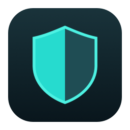
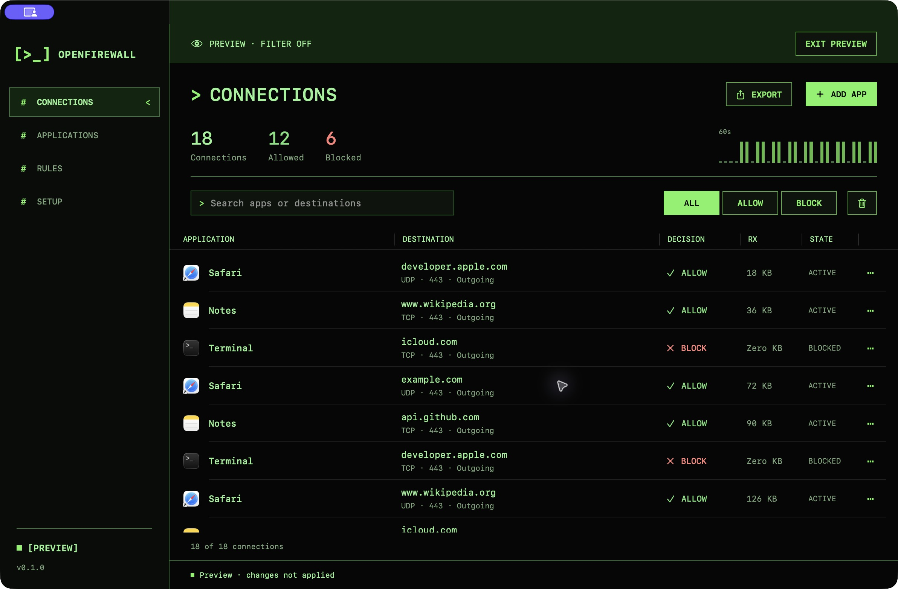

<p align="center">
  
</p>

<h1 align="center">OpenFirewall</h1>

<p align="center">Open-source macOS firewall. Per-app rules and connection monitoring.</p>

<p align="center">
  <a href="https://github.com/fberrez/openfirewall/actions/workflows/build.yml"></a>
  <a href="LICENSE"></a>
  
  
</p>



*Alpha.2 interface with sample connections.*

## What it does

- **Allow or block an app.** Create a rule before it connects, or select an app already seen on the network.
- **See connection decisions.** View apps, destinations, ports, protocols, direction, state, and byte counts.
- **Apply changes to open connections.** A Block change also drops tracked, currently allowed flows for that app.
- **Keep filtering when the window closes.** The system extension runs separately from the interface.
- **Keep data local.** Search the latest 500 connections and export retained history as JSON.

Native SwiftUI interface. No accounts, subscriptions, license keys, telemetry, or third-party runtime dependencies.

## Install

**[Download OpenFirewall for macOS](https://github.com/fberrez/openfirewall/releases/download/v0.1.0-alpha.2/OpenFirewall-0.1.0-alpha.2-universal.dmg)** · [Release notes and checksums](https://github.com/fberrez/openfirewall/releases/tag/v0.1.0-alpha.2)

1. Open the downloaded disk image.
2. Drag **OpenFirewall** to **Applications**.
3. Open OpenFirewall from Applications.
4. In **Setup**, click **Enable firewall**. Approve the system extension and network filter when macOS asks.
5. In **Applications**, click **+ Add app**, select an app, and choose **Allow** or **Block**.

The app is Developer ID-signed and notarized by Apple. The download includes Apple Silicon and Intel binaries. You do not need Xcode or an Apple Developer account to install it. macOS approval is required for network filtering.

To upgrade, quit the interface, replace the app in Applications, reopen it, and choose **Setup → Update firewall**. Your saved rules are retained. macOS may request approval for the extension update. Reconnect or restart affected apps to replace local connections opened before the update.

## Project status

**Early alpha, version 0.1.0-alpha.2 (build 7).** Actual TCP and UDP tests on one Apple Silicon Mac passed Allow → Block → Allow. Tests also confirmed that Block disconnects an existing TCP connection and continues working after quitting the interface. The local-proxy fix passed IPv4 and IPv6 TCP/UDP checks on extension build 6; build 7 retains the same filter logic and simplifies the interface.

The signed public alpha is available above. To build your own version, see [Building and installation](docs/building.md). Signing and provisioning are required for self-built versions that enable live filtering.

macOS 14 is the deployment target. Live verification used macOS 26.2 on Apple Silicon. The Intel binary builds, but has not been tested on an Intel Mac. Compatibility across other Macs and network configurations is still being checked. [Verification details and release checklist](VERIFY.md).

## Roadmap

The priority is a reliable public alpha. Later features depend on testing and feedback. There are no committed release dates.

### Implemented foundation

- [x] Per-app Allow and Block rules with a configurable default.
- [x] Local connection monitor, search, decision filters, and JSON export.
- [x] Drop tracked open connections when an app changes to Block.
- [x] Keep an enabled filter running after quitting the interface.
- [x] Core tests, identity checks, and automated unsigned builds.

Live enforcement has been verified on one Mac. These checks do not establish compatibility across all supported systems.

### Next: public alpha

- [x] Provide a Developer ID-signed, notarized alpha download.
- [ ] Improve setup guidance and recovery when macOS approval is pending or denied.
- [ ] Validate app upgrades, extension replacement, disabling, and removal.
- [ ] Verify saved rules after reboot and recovery after provider crashes.
- [ ] Measure CPU use, memory, and connection latency under load.

### Then: broader compatibility

- [ ] Test more macOS versions and hardware configurations.
- [ ] Verify IPv4, IPv6, UDP, and incoming flows across local, remote, and VPN routes.
- [ ] Test helper attribution, multiple users, and coexistence with other network filters.
- [ ] Exercise the existing-flow tracking limit and improve its handling.

The detailed acceptance checks are in [VERIFY.md](VERIFY.md).

### Later candidates

- [ ] Optional prompts for apps without a rule, with clear timeout behavior.
- [ ] Temporary rules and rule import/export.
- [ ] Destination, port, and protocol rules with documented precedence.
- [ ] Optional local history with retention controls and per-app traffic summaries.
- [ ] Research better hostname attribution while preserving encrypted connections.

These are proposed directions, not available features. [Suggest a priority or use case](https://github.com/fberrez/openfirewall/issues/new?template=feature_request.yml).

## Build from source

Requirements: macOS 14+, Xcode with Swift 6+, and [XcodeGen](https://github.com/yonaskolb/XcodeGen).

```sh
git clone https://github.com/fberrez/openfirewall.git
cd openfirewall
brew install xcodegen
swift test
bash Scripts/test-identity.sh
bash Scripts/build.sh
```

The unsigned app is created at `build/Build/Products/Release/OpenFirewall.app`. Open it and choose **Preview** to try the interface with sample data. An unsigned build cannot enable the network filter.

For a working firewall, follow the [signed development build instructions](docs/building.md#enable-live-filtering).

## Use OpenFirewall

After [installing OpenFirewall](#install):

1. Open **Setup** and choose **Enable firewall**. Complete the macOS approval prompts.
2. Open **Applications**. Click **+ Add app** at the top right.
3. Search for an app, select it, and choose **Allow** or **Block**. **Browse…** selects an app or executable elsewhere.
4. Open **Connections** to see decisions and traffic counters.

Apps are **allowed by default**. An explicit app rule overrides the default. Change the default or remove a rule in **Rules**. Removing a rule restores the default for that app.

**+ Add app** is available on **Connections**, **Applications**, and **Rules**.

The current interface defaults to a green terminal theme. Choose **Terminal**, **Daylight**, or **System** in **Setup → Appearance**. Use **⌘1–⌘4** to switch pages, **⌘N** to add an app, and **⌘E** to export connections.

Closing or quitting the interface leaves an enabled filter running. To stop filtering, choose **Setup → Disable firewall**. Already blocked connections need to reconnect after changing their rule to Allow.

## Privacy and limits

OpenFirewall records connection metadata. It does not inspect payloads, decrypt TLS, rewrite DNS, or inspect ECH. Hostnames appear when macOS supplies them; other destinations may appear as IP addresses.

**Alpha.2 fixes local-proxy bypasses:** app rules also cover IPv4 loopback (`127.0.0.0/8`) and IPv6 loopback (`::1`), including local HTTP and SOCKS proxies. Alpha.1 does not contain this fix. Reconnect apps after updating the extension so existing untracked local connections are replaced.

- History stays in extension memory and resets when the extension stops. Only the latest 500 records are retained.
- Byte counts use macOS reports, requested about every five seconds. Short or blocked flows may show zero bytes.
- Rules persist in macOS filter preferences and in `~/Library/Application Support/OpenFirewall/rules.json`.
- Rules use verified code-signing identity, not an app's name or file path. Helpers can have separate identities. Some binaries receive a **Pinned build** rule that must be recreated after an update.
- The filter decides socket flows delivered by macOS. Coverage of every VPN, IPv6, incoming, or system-service path has not been established.
- Up to 16,384 allowed flows are retained for later rule changes. At the limit, new flows still receive decisions, but some existing flows cannot be revoked. The interface shows a warning.
- Behavior during a provider crash is not guaranteed to block traffic. Reboot, recovery, and distribution testing remain on the [release checklist](VERIFY.md).

See [Architecture and rule behavior](docs/architecture.md) for the exact identity, enforcement, and control model.

## Contribute

Bug reports, focused pull requests, and signed-device testing are welcome.

- [Report a bug](https://github.com/fberrez/openfirewall/issues/new?template=bug_report.yml)
- [Suggest a feature](https://github.com/fberrez/openfirewall/issues/new?template=feature_request.yml)
- [Contributing guide](CONTRIBUTING.md)
- [Report a security issue privately](SECURITY.md)

## License

[MIT](LICENSE) — free to use, modify, and redistribute, including commercially. Keep the copyright and license notice with copies. OpenFirewall is an independent implementation using public macOS APIs.
