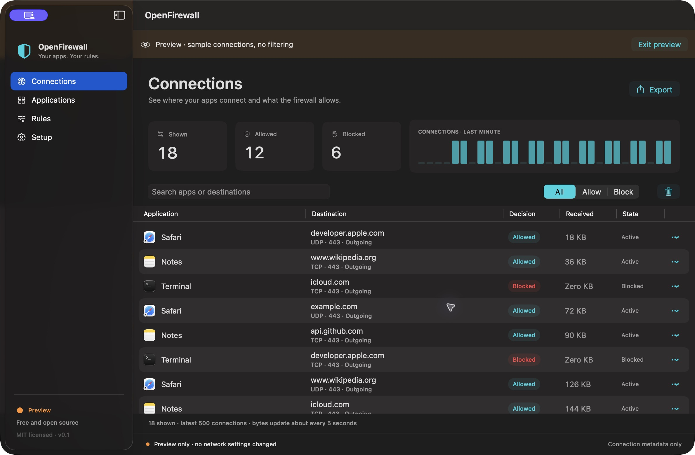

<p align="center">
  
</p>

<h1 align="center">OpenFirewall</h1>

<p align="center">Your apps. Your rules.</p>
<p align="center">A free, open-source macOS firewall with per-app controls and a local connection monitor.</p>

<p align="center">
  <a href="https://github.com/fberrez/openfirewall/actions/workflows/build.yml"></a>
  <a href="LICENSE"></a>
  
  
</p>



*Interface preview with sample connections. It does not display anyone's network history.*

## What it does

- **Allow or block an app.** Create a rule before it connects, or select an app already seen on the network.
- **See connection decisions.** View apps, destinations, ports, protocols, direction, state, and byte counts.
- **Apply changes to open connections.** A Block change also drops tracked, currently allowed flows for that app.
- **Keep filtering when the window closes.** The system extension runs separately from the interface.
- **Keep data local.** Search the latest 500 connections and export retained history as JSON.

Native SwiftUI interface. No accounts, subscriptions, license keys, telemetry, or third-party runtime dependencies.

## Project status

**Early development, version 0.1.** A development-signed build has been tested on one Apple Silicon Mac. Actual TCP and UDP tests passed Allow → Block → Allow. Tests also confirmed that Block disconnects an existing TCP connection and continues working after quitting the interface.

There is **no ready-to-install, notarized public download yet**. Building the interface is straightforward. Enabling live filtering also requires Apple signing, provisioning, and approval in macOS. See [Building and installation](docs/building.md).

macOS 14 is the deployment target. Live verification used macOS 26.2. Compatibility across other Macs and network configurations is still being checked. [Verification details and release checklist](VERIFY.md).

## Build from source

Requirements: macOS 14+, Xcode with Swift 6+, and [XcodeGen](https://github.com/yonaskolb/XcodeGen).

```sh
git clone https://github.com/fberrez/openfirewall.git
cd openfirewall
brew install xcodegen
swift test
bash Scripts/test-identity.sh
bash Scripts/build.sh
```

The unsigned app is created at `build/Build/Products/Release/OpenFirewall.app`. Open it and choose **Explore preview** to try the interface with sample data. An unsigned build cannot enable the network filter.

For a working firewall, follow the [signed development build instructions](docs/building.md#enable-live-filtering).

## Use OpenFirewall

After installing and approving a signed build:

1. Open **Setup** and choose **Enable firewall**. Complete the macOS approval prompts.
2. Open **Applications**. Click **+ Add app** at the top right.
3. Search for an app, select it, and choose **Allow** or **Block**. **Choose another file…** lets you select an app or executable elsewhere.
4. Open **Connections** to see decisions and traffic counters.

Apps are **allowed by default**. An explicit app rule overrides the default. Change the default or remove a rule in **Rules**. Removing a rule restores the default for that app.

**+ Add app** also appears on **Rules**. It does not appear on **Connections**.

Closing or quitting the interface leaves an enabled filter running. To stop filtering, choose **Setup → Disable firewall**. Already blocked connections need to reconnect after changing their rule to Allow.

## Privacy and limits

OpenFirewall records connection metadata. It does not inspect payloads, decrypt TLS, rewrite DNS, or inspect ECH. Hostnames appear when macOS supplies them; other destinations may appear as IP addresses.

- History stays in extension memory and resets when the extension stops. Only the latest 500 records are retained.
- Byte counts use macOS reports, requested about every five seconds. Short or blocked flows may show zero bytes.
- Rules persist in macOS filter preferences and in `~/Library/Application Support/OpenFirewall/rules.json`.
- Rules use verified code-signing identity, not an app's name or file path. Helpers can have separate identities. Some binaries receive a **Pinned build** rule that must be recreated after an update.
- The filter decides socket flows delivered by macOS. Coverage of every VPN, IPv6, incoming, or system-service path has not been established.
- Up to 16,384 allowed flows are retained for later rule changes. At the limit, new flows still receive decisions, but some existing flows cannot be revoked. The interface shows a warning.
- Behavior during a provider crash is not guaranteed to block traffic. Reboot, recovery, and distribution testing remain on the [release checklist](VERIFY.md).

See [Architecture and rule behavior](docs/architecture.md) for the exact identity, enforcement, and control model.

## Contribute

Bug reports, focused pull requests, and signed-device testing are welcome.

- [Report a bug](https://github.com/fberrez/openfirewall/issues/new?template=bug_report.yml)
- [Suggest a feature](https://github.com/fberrez/openfirewall/issues/new?template=feature_request.yml)
- [Contributing guide](CONTRIBUTING.md)
- [Report a security issue privately](SECURITY.md)

Near-term work includes broader device testing, reliable upgrade and removal flows, and a signed, notarized public release. These are planned areas, not available features.

## License

[MIT](LICENSE) — free to use, modify, and redistribute, including commercially. Keep the copyright and license notice with copies. OpenFirewall is an independent implementation using public macOS APIs.
